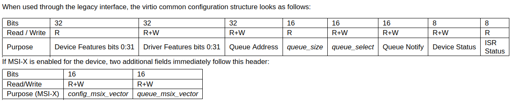

# Device Initialization

After successfully registering the device, we will now start communicating with the device. The first thing we need to do is to initialize the device. 

In device initialization, there are two parts we need to deal with: the PCI bus and the device. We will refer to each of them using the following resources:

- [Virtio documentation](https://docs.oasis-open.org/virtio/virtio/v1.2/cs01/virtio-v1.2-cs01.html) (for device)
- `linux-6.18.58/Documentation/PCI/pci.rst` (for PCI bus)

**Other Useful Resources**:

1. [PCI Linux kernel documentation](https://docs.kernel.org/driver-api/pci/pci.html), to search for function signature
2. [Generic kernel errors documentation](https://docs.kernel.org/userspace-api/media/gen-errors.html), to search for return error type
3. [Kernel print format](https://docs.kernel.org/core-api/printk-formats.html)

## PCI Bus

For PCI bus, we will refer to `linux-6.18.58/Documentation/PCI/pci.rst`, specifically on **Device Initialization Steps** given below. In this section, we will focus on the **first two steps** as our main goal is to interact with the I/O registers. 

```rst
Device Initialization Steps
===========================

As noted in the introduction, most PCI drivers need the following steps
for device initialization:

  - Enable the device
  - Request MMIO/IOP resources
  - Set the DMA mask size (for both coherent and streaming DMA)
  - Allocate and initialize shared control data (pci_allocate_coherent())
  - Access device configuration space (if needed)
  - Register IRQ handler (request_irq())
  - Initialize non-PCI (i.e. LAN/SCSI/etc parts of the chip)
  - Enable DMA/processing engines.

The driver can access PCI config space registers at any time.
(Well, almost. When running BIST, config space can go away...but
that will just result in a PCI Bus Master Abort and config reads
will return garbage).
```

### I. Enable the device

```rst
Enable the PCI device
---------------------
Before touching any device registers, the driver needs to enable
the PCI device by calling pci_enable_device(). This will:

  - wake up the device if it was in suspended state,
  - allocate I/O and memory regions of the device (if BIOS did not),
  - allocate an IRQ (if BIOS did not).

.. note::
   pci_enable_device() can fail! Check the return value.

...
```

Beside using `pci_enable_device()`, we can use `pcim_enable_device()`, the managed version that ensures the device will automatically disabled on driver detach. 

The signature is as follows (from Other Useful Resources 1):

```c
int pcim_enable_device(struct pci_dev *pdev)
```

As alarmed, we will check the return value of such call to ensure that we have successfully enabled the device. 

### II. Request MMIO/IOP resources

```rst
Request MMIO/IOP resources
--------------------------
Memory (MMIO), and I/O port addresses should NOT be read directly
from the PCI device config space. Use the values in the pci_dev structure
as the PCI "bus address" might have been remapped to a "host physical"
address by the arch/chip-set specific kernel support.

See Documentation/driver-api/io-mapping.rst for how to access device registers
or device memory.

The device driver needs to call pci_request_region() to verify
no other device is already using the same address resource.
Conversely, drivers should call pci_release_region() AFTER
calling pci_disable_device().
The idea is to prevent two devices colliding on the same address range.

.. tip::
   See OS BUG comment above. Currently (2.6.19), The driver can only
   determine MMIO and IO Port resource availability _after_ calling
   pci_enable_device().

Generic flavors of pci_request_region() are request_mem_region()
(for MMIO ranges) and request_region() (for IO Port ranges).
Use these for address resources that are not described by "normal" PCI
BARs.

Also see pci_request_selected_regions() below.
```

Next, because device memory and I/O port addresses cannot be accessed directly, you need to map this space. However, beforehand, you will first need to request fo the resources to ensure that no other device is already using the same resources. 

We will also use the managed version of `pci_request_region()`, `pcim_request_region()` such that the region will automatically be released on driver detach. 

The signature is as follows (from Other Useful Resources 1):

```c
int pcim_request_region(struct pci_dev *pdev, int bar, const char *name)
```

The second argument, `bar`, indicates the index of BAR to request, and the third argument, `name`, indicates the name of the driver requesting the resource. 

> **Notes:** BAR0 is the region of interest for our device. How can you know? Virtio documentation 4.1.4.10 first paragraph. We will discuss this further on the following section. 

### III. Map BAR0

If the request for resources is successful, we will now map BAR0 using `pcim_iomap()`, also a managed version. 

The signature of the function is as follows:

```c
void __iomem *pcim_iomap(struct pci_dev *pdev, int bar, unsigned long maxlen)
```

We should pass 0 to `maxlen` to get access to the complete BAR. By checking at the kernel-doc comment (look at Developer Notes 2), we should also check whether the return value is `NULL`. If so, we will return `-ENOMEM` (check Other Useful Resources 2). 

## Device

After successfully mapping BAR0, we now need to follow the virtio documentation on how to initialize the device, specifically chapter 3.1.1. In this section, we will particularly focus on the **first three steps**:

- Reset the device.
- Set the ACKNOWLEDGE status bit: the guest OS has noticed the device.
- Set the DRIVER status bit: the guest OS knows how to drive the device. 

### I. Reset the device

What does it means by resetting the device? We need to check the virtio documentation and see what is required from the driver. Yes, it is in chapter 2.4.2.

> The driver SHOULD consider a driver-initiated reset complete when it reads *device status* as 0. 

To understand what it means by *device status*, we will need to refer to chapter 4.1.4.10, where the configuration structure is specified. 



Device status is the seventh section. To perform read and write operations to these sections, we can utilize `ioread8`, `ioread16`, `ioread32`, `iowrite8`, `iowrite16`, `iowrite32` functions. 

To refer to the section locations in terms of bytes, you could utilize the macro `VIRTIO_PCI_STATUS` in `virtio_pci.h`, and add it to the `__iomem` handles. To reset, you need to set the value to 0, therefore the code will be as follows:

```c
void __iomem *status_loc = ioaddr + VIRTIO_PCI_STATUS;
iowrite8(0, status_loc); // reset
```

### II. Set ACKNOWLEDGE and DRIVER status

Next, we need to set two device status field, which is ACKNOWLEDGE and DRIVER. To know the value that we need to set, we should refer to the virtio documentation chapter 2.1. 

Though, in the code, we will refer to the macro `VIRTIO_CONFIG_S_ACKNOWLEDGE` and `VIRTIO_CONFIG_S_DRIVER` from `virtio_config.h`. The code will be as follows:

```c
u8 status = ioread8(status_loc);
status |= VIRTIO_CONFIG_S_ACKNOWLEDGE; // set ACKNOWLEDGE
iowrite8(status, status_loc);
status |= VIRTIO_CONFIG_S_DRIVER; // set DRIVER
iowrite8(status, status_loc);
```

## MAC Address

MAC address lives in the device-specific configuration layout, according to the virtio documentation chapter 5.1.4. As described in chapter 4.1.4.10, device-specific configuration immediately follows the general headers. 

The structure of the configuration is described in 5.1.4 as well:

```c
struct virtio_net_config { 
    u8 mac[6]; 
    le16 status; 
    le16 max_virtqueue_pairs; 
    le16 mtu; 
    le32 speed; 
    u8 duplex; 
    u8 rss_max_key_size; 
    le16 rss_max_indirection_table_length; 
    le32 supported_hash_types; 
};
```

As we do not enable MSI-X, we will use `VIRTIO_PCI_CONFIG_OFF(false)` from `virtio_pci.h`. Then, we will read the next 6 bytes of MAC address accordingly. The code is given below. 

```c
void __iomem *conf_loc = ioaddr + VIRTIO_PCI_CONFIG_OFF(false);
u8 mac_addr[6];
for (int i = 0; i < 6; i++) {
    mac_addr[i] = ioread8(conf_loc);
    conf_loc++;
}
```

However, before this, we also need to add a check on `VIRTIO_NET_F_MAC` as the mac address field is only valid when this bit is set. From chapter 5.1.3, we can know that this bit belong to the feature. Because this bit indicates what the host (device) offers, this bit will be in `ioaddr + VIRTIO_PCI_HOST_FEATURES`. The check for this is therefore as such:

```c
if (used_feat & (1u << VIRTIO_NET_F_MAC)) { ... }
```

## Developer Notes

1. Do not mixed up managed with manual managed. 

2. In the kernel, the kernel-doc comment almost always sits above the definition, in the `.c` file. The `.h` usually has only the bare declaration. The exception is static inline functions, which are defined in the header, so their docs are there too.

    ```bash
    grep -rn "^ \* pcim_iomap - " ~/skiff-work/linux-6.18.58/drivers/pci
    ```
Otherwise, you can also check the notes on the kernel documentations in the website. For `pcim_iomap`, it is [here](https://docs.kernel.org/driver-api/pci/pci.html#c.pcim_iomap). 
