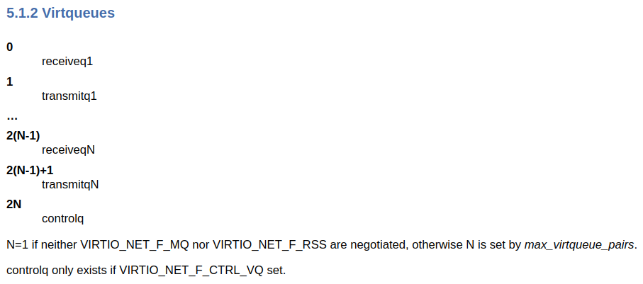

# Virtqueues

Similar to device initialization, we are also provided instructions by the virtio documentations on how to configure virtqueues. In chapter 4.1.5.1.3, the following is mentioned:

> The driver typically does this as follows, for each virtqueue a device has:

> - Write the virtqueue index (first queue is 0) to queue_select.
> - Read the virtqueue size from queue_size. This controls how big the virtqueue is (see 2.6 Virtqueues). If this field is 0, the virtqueue does not exist.
> - Optionally, select a smaller virtqueue size and write it to queue_size.
> - Allocate and zero Descriptor Table, Available and Used rings for the virtqueue in contiguous physical memory.
> - Optionally, if MSI-X capability is present and enabled on the device, select a vector to use to request interrupts triggered by virtqueue events. Write the MSI-X Table entry number corresponding to this vector into queue_msix_vector. Read queue_msix_vector: on success, previously written value is returned; on failure, NO_VECTOR value is returned.

It is mentioned that a device can have zero or more virtqueues, then a question is: how can we know **how many virtqueues** available in our device? This is answered in chapter 5.1.2.

Because we do not negotiate for `VIRTIO_NET_F_MQ` and `VIRTIO_NET_F_RSS`, there are only 2 virtqueues we will need to allocate. 

<em>- Coming soon -</em>
